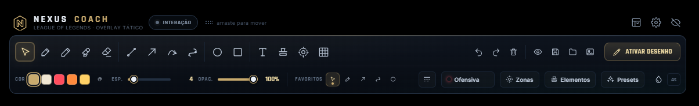
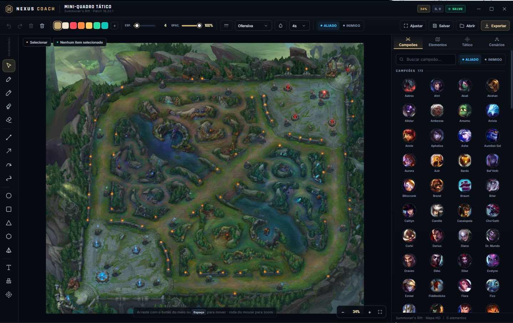

# Nexus Coach




Overlay de coaching tático para **League of Legends**, inspirado na praticidade do Epic Pen e com ferramentas específicas para análise de replay, aula e demonstração de estratégia.

O programa é uma camada transparente sobre a tela, com barra flutuante, desenho sobre o jogo, Click-Through, tinta temporária, biblioteca de campeões/elementos e um **Mini-Quadro Tático** independente com Summoner's Rift em alta resolução.

## Idealização

O Nexus Coach foi idealizado por **Nappy**, criador do canal [@nappybr no YouTube](https://www.youtube.com/@nappybr). Jogador assíduo de League of Legends, Nappy procurava uma ferramenta prática que o ajudasse em suas aulas e na explicação visual de estratégias — algo simples como o Epic Pen, mas pensado especificamente para o universo de LoL.

Foi dessa necessidade que nasceu o Nexus Coach: reunir desenho em tempo real, ferramentas táticas, biblioteca de elementos e um mini-quadro de Summoner's Rift em um único programa feito para coaches e professores do jogo.

- **Criador:** Nappy
- **YouTube:** [youtube.com/@nappybr](https://www.youtube.com/@nappybr)
- **Jogo:** League of Legends

## Requisitos

- Windows 10 ou 11
- League of Legends em modo de vídeo **Sem bordas (Borderless)** para que o overlay apareça sobre o jogo
- Para desenvolvimento: Node.js 20+ e npm

## Executar

```bash
npm install
npm start
```

Ou execute o instalador/portátil gerado em `release/`.

## Gerar o instalador Windows

```bash
npm run dist:win
```

São gerados um instalador NSIS e um executável portátil em `release/`.

## Primeiros passos

1. Abra o Nexus Coach. A barra flutuante aparece no topo da tela.
2. Clique em uma ferramenta (ou use o atalho). O modo desenho é ativado automaticamente.
3. Desenhe sobre o jogo/replay.
4. Clique em **Desenhando** na barra para voltar ao modo de interação (Click-Through) e controlar o jogo.
5. Use **Mini-Quadro** para abrir o quadro tático com o mapa de Summoner's Rift.
6. Use **Elementos** para carimbar campeões, sentinelas, torres, dragões, Barão e outros.
7. Use **Presets** para salvar e reaplicar combinações de ferramenta, cor, espessura e estilo.

A barra pode ser arrastada pela parte superior e redimensionada pelas bordas. A posição e o tamanho são lembrados entre sessões.

## Atalhos padrão

| Ação | Atalho |
| --- | --- |
| Alternar desenho / interação | Ctrl + Shift + D |
| Ocultar / mostrar interface | Ctrl + Shift + H |
| Abrir / fechar Mini-Quadro | Ctrl + Shift + M |
| Limpar marcações | Ctrl + Shift + X |
| Caneta | P |
| Lápis | B |
| Marca-texto | H |
| Borracha | E |
| Linha | L |
| Seta | A |
| Rota tática | R |
| Círculo | C |
| Retângulo | X |
| Texto | T |
| Elementos | S |
| Zonas AoE | O |
| Tinta temporária | I |
| Ocultar / mostrar marcações | F |
| Desfazer / refazer | Ctrl+Z / Ctrl+Shift+Z |
| Cancelar ferramenta | Esc |

Todos os atalhos são editáveis em **Configurações → Atalhos**. Atalhos globais usam Ctrl/Alt/Shift para não conflitar com o jogo; os atalhos de ferramentas são contextuais ao modo desenho.

## Recursos principais

- Caneta, lápis, marca-texto, borracha, linha, setas retas/curvas, rotas, círculos, elipses, retângulos, triângulos, hexágonos, cones e texto.
- Cores, espessura, opacidade, estilos de traço e estilos táticos de seta (ofensiva, defensiva, prevista, executada, gank, fuga, visão).
- Seleção múltipla, mover, redimensionar, rotacionar, copiar/colar, duplicar, desfazer/refazer.
- Tinta temporária com duração configurável e limpeza automática do overlay.
- Click-Through instantâneo, captura de tela com marcações e exportação PNG.
- Biblioteca com 173 campeões (ícones do Data Dragon) e elementos do mapa: sentinelas, pings, minions, torres, inibidor, Nexus, dragões, Barão, Arauto, Vastilarva e acampamentos.
- Zonas de alcance, cones, visão de sentinela, alcance de torre, áreas de ameaça, engage/disengage e teamfight.
- Mini-Quadro com mapa HD 2600 px, zoom, pan, fundo ajustável, grade, ondas (freeze/slow push/fast push), cenários prontos e salvamento automático.
- Presets de coaching, paleta personalizável, favoritos reordenáveis e restauração de padrões.
- Tema Hextech/Nocturne, quatro cores de destaque e configurações persistentes em `%APPDATA%\Nexus Coach\nexus-coach.json`.

## Estrutura

```text
main.js                 processo principal Electron
preload.js              API segura exposta aos renderers
src/renderer/           overlay, barra, mini-quadro, configurações e engine de desenho
src/shared/catalog.json catálogo de estilos, zonas, presets e elementos
assets/                 mapa, ícones de elementos, campeões e fontes
```

## Notas

- O overlay é uma janela transparente sempre no topo; não injeta código no jogo e não interfere no anti-cheat. Em tela cheia exclusiva o Windows pode ocultar overlays; use **Sem bordas**.
- O aplicativo é independente e não é afiliado à Riot Games. League of Legends, Summoner's Rift e os ícones de campeões pertencem à Riot Games, Inc. Os ativos são carregados do Data Dragon/CommunityDragon e de material público da comunidade.
- Nenhum dado é enviado para servidores; configurações, desenhos e presets ficam apenas no computador local.
