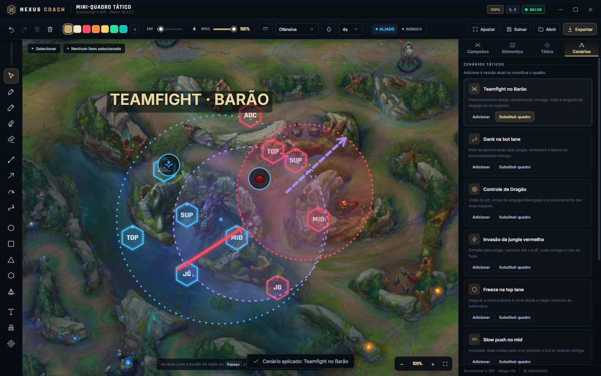
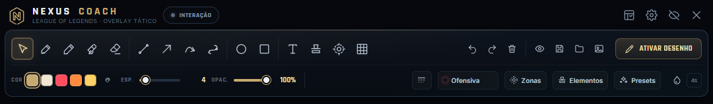
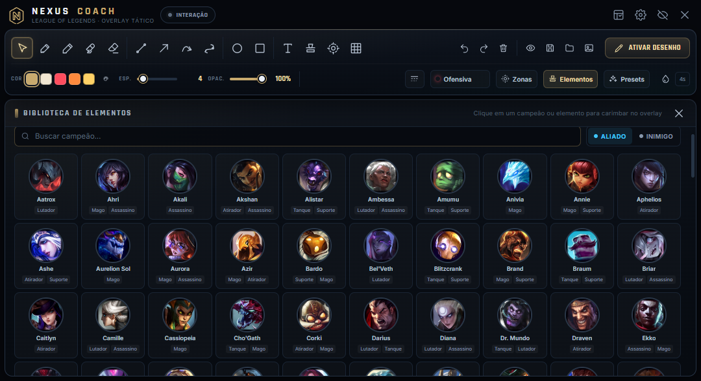
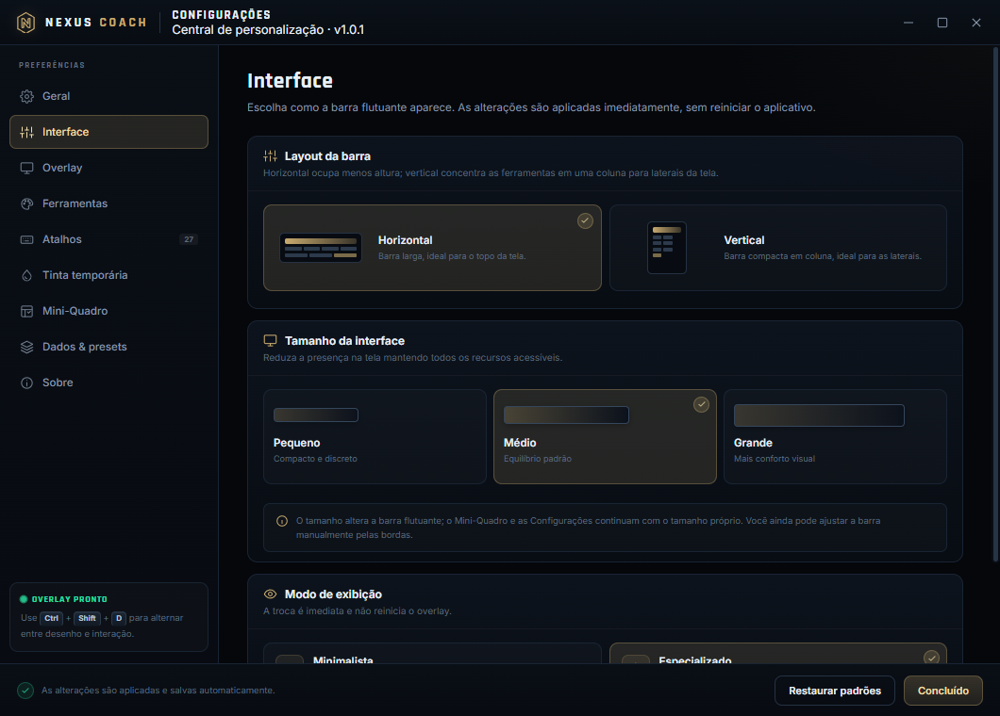

# Nexus Coach

<p align="center">
  
</p>

<p align="center">
  <b>Overlay de coaching tático para League of Legends.</b><br>
  Desenhe sobre o jogo, marque rotas e zonas, carimbe campeões e monte cenários no Mini-Quadro de Summoner's Rift.
</p>

## Baixar

| Instalador | Versão portátil |
| :---: | :---: |
| [NexusCoach-1.0.1-x64.exe](https://github.com/michaelrobertt/nexus-coach/releases/download/v1.0.1/NexusCoach-1.0.1-x64.exe) | [NexusCoach-Portable-1.0.1.exe](https://github.com/michaelrobertt/nexus-coach/releases/download/v1.0.1/NexusCoach-Portable-1.0.1.exe) |
| Instala no Windows, com atalho na área de trabalho | Executa sem instalar |

[Página da release](https://github.com/michaelrobertt/nexus-coach/releases/tag/v1.0.1) · Windows 10/11 · 64 bits

> Os executáveis não são assinados digitalmente. O Windows SmartScreen pode pedir confirmação na primeira execução.

## Capturas

### Barra flutuante

<p align="center">
  
</p>

Barra horizontal com ferramentas de desenho, cores, espessura, opacidade, favoritos, zonas, elementos e presets. Também pode ser usada na vertical.

### Biblioteca de elementos

<p align="center">
  
</p>

Biblioteca com os 173 campeões e elementos do mapa para carimbar diretamente sobre o jogo ou no Mini-Quadro.

### Configurações

<p align="center">
  
</p>

Layout, tamanho, modo de exibição, tema, atalhos, tinta temporária e preferências do Mini-Quadro são aplicados sem reiniciar o aplicativo.

## Idealização

O Nexus Coach foi idealizado por **Nappy**, criador do canal [@nappybr no YouTube](https://www.youtube.com/@nappybr). Jogador assíduo de League of Legends, Nappy procurava uma ferramenta prática para suas aulas e para explicar estratégias visualmente — algo simples como o Epic Pen, mas pensado especificamente para o universo de LoL.

- **Criador:** Nappy
- **YouTube:** [youtube.com/@nappybr](https://www.youtube.com/@nappybr)
- **Jogo:** League of Legends

## Requisitos

- Windows 10 ou 11, 64 bits
- League of Legends em modo de vídeo **Sem bordas** para o overlay aparecer sobre o jogo
- Para desenvolvimento: Node.js 20+ e npm

## Instalação

1. Baixe o instalador ou o executável portátil.
2. Feche o League of Legends antes de instalar, se ele estiver aberto.
3. Execute o arquivo baixado.
4. Abra o Nexus Coach e mantenha o jogo em **Sem bordas**.

O modo **Tela cheia** exclusiva do Windows pode esconder overlays. Nesse caso, use **Sem bordas** nas opções de vídeo do jogo.

## Uso rápido

1. Abra o Nexus Coach. A barra flutuante aparece no topo da tela.
2. Clique em **Ativar desenho** ou selecione uma ferramenta. O overlay passa a capturar o mouse para desenhar.
3. Desenhe sobre o jogo ou replay.
4. Clique em **Interagir** para voltar ao Click-Through e controlar o jogo normalmente.
5. Use **Mini-Quadro** para abrir o quadro tático de Summoner's Rift.
6. Use **Elementos** para carimbar campeões, sentinelas, torres, dragões, Barão e outros elementos.
7. Use **Presets** para salvar e reaplicar combinações de ferramenta, cor, espessura e estilo.
8. O botão à esquerda do **X** minimiza o aplicativo para um botão flutuante. Arraste o botão para reposicioná-lo e clique nele para restaurar a interface.

A barra pode ser arrastada pela parte superior e redimensionada pelas bordas. Posição, tamanho, layout e preferências são lembrados entre sessões.

## Atalhos padrão

| Ação | Atalho |
| --- | --- |
| Alternar desenho / interação | Ctrl + Shift + D |
| Ocultar / mostrar interface | Ctrl + Shift + H |
| Abrir / fechar Mini-Quadro | Ctrl + Shift + M |
| Limpar marcações | Ctrl + Shift + X |
| Caneta | P |
| Lápis | B |
| Marca-texto | H |
| Borracha | E |
| Linha | L |
| Seta | A |
| Rota tática | R |
| Círculo | C |
| Retângulo | X |
| Texto | T |
| Elementos | S |
| Zonas AoE | O |
| Tinta temporária | I |
| Ocultar / mostrar marcações | F |
| Desfazer / refazer | Ctrl+Z / Ctrl+Shift+Z |
| Cancelar ferramenta | Esc |

Todos os atalhos são editáveis em **Configurações → Atalhos**. Os atalhos globais usam Ctrl, Alt ou Shift para não conflitar com o jogo; os atalhos de ferramentas são contextuais ao modo desenho.

## Recursos

- Caneta, lápis, marca-texto, borracha, linha, setas retas/curvas, rotas, círculos, elipses, retângulos, triângulos, hexágonos, cones e texto.
- Cores, espessura, opacidade, estilos de traço e estilos táticos de seta: ofensiva, defensiva, prevista, executada, gank, fuga e visão.
- Seleção múltipla, mover, redimensionar, rotacionar, copiar/colar, duplicar, desfazer/refazer.
- Tinta temporária com duração configurável e limpeza automática.
- Click-Through instantâneo, captura de tela com marcações e exportação PNG.
- Biblioteca com 173 campeões (ícones do Data Dragon) e elementos do mapa: sentinelas, pings, minions, torres, inibidor, Nexus, dragões, Barão, Arauto, Vastilarva e acampamentos.
- Zonas de alcance, cones, visão de sentinela, alcance de torre, áreas de ameaça, engage/disengage e teamfight.
- Mini-Quadro com mapa HD de 2600 px, zoom, pan, fundo ajustável, grade, controle de ondas, oito cenários prontos e salvamento automático.
- Presets de coaching, paleta personalizável, favoritos reordenáveis e restauração de padrões.
- Temas Hextech e Nocturne, quatro cores de destaque e configurações persistentes em `%APPDATA%\Nexus Coach\nexus-coach.json`.
- Barra flutuante com layouts **horizontal/vertical**, tamanhos **pequeno/médio/grande**, modos **minimalista/especializado** e botão flutuante para minimizar/restaurar o aplicativo.

## Mini-Quadro

O Mini-Quadro é uma janela independente com o mapa de Summoner's Rift em alta resolução. Ele inclui:

- Camadas de fundo: mapa HD, minimapa ou modo escuro com grade.
- Ferramentas de desenho, setas táticas, zonas e carimbos de campeões/elementos.
- Cenários prontos: Teamfight no Barão, Gank na bot lane, Controle de Dragão, Invasão da jungle vermelha, Freeze na top lane, Slow push no mid, Fast push na bot e Controle de visão do rio.
- Posicionamento de ondas e rótulos táticos.
- Salvamento automático do quadro e exportação em PNG.

## Desenvolvimento

```bash
npm install
npm start       # inicia o aplicativo
npm test        # testes end-to-end com Electron/Playwright
npm run dist:win
```

`npm run dist:win` gera o instalador NSIS e o executável portátil em `release/`.

## Estrutura

```text
main.js                  processo principal do Electron
preload.js               API segura exposta aos renderers
src/renderer/            overlay, barra, Mini-Quadro, configurações e engine de desenho
src/shared/catalog.json  catálogo de estilos, zonas, presets e elementos
assets/                  mapa, ícones de elementos, campeões e fontes
tests/                   testes end-to-end
docs/screenshots/        capturas usadas no README
```

## Notas

- O overlay é uma janela transparente sempre no topo; ele não injeta código no jogo e não interfere no anti-cheat. Em tela cheia exclusiva o Windows pode ocultar overlays; use **Sem bordas**.
- O aplicativo é independente e não é afiliado à Riot Games. League of Legends, Summoner's Rift e os ícones de campeões pertencem à Riot Games, Inc. Os ativos são carregados do Data Dragon/CommunityDragon e de material público da comunidade.
- Nenhum dado é enviado para servidores; configurações, desenhos e presets ficam apenas no computador local.

## Licença

MIT. Consulte [LICENSE](LICENSE).
